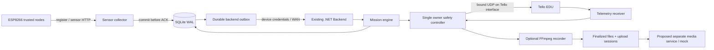

# Gateway design and phase plan

The approved objective supplies the scope and authorizes implementation after presenting this audit. Implement within `raspberry-pi-gateway/` on `feature/raspberry-pi-gateway`; existing Backend and both firmware branches remain unchanged.

## Architecture

Python standard library handles HTTP, UDP, SQLite, subprocesses and configuration. pytest is a development dependency. Small synchronous workers and bounded threads avoid a heavy framework. One Store connection with serialized transactions protects writes from registration and background workers. FULL synchronous WAL protects commit-before-ACK within actual filesystem/hardware limits.

All persisted outbound bodies are immutable. Sync acknowledgment matches batchKey, index and identity. Rejected entries remain; unknown responses never advance state. Network retries use capped exponential delay; authentication/configuration/plan conflicts are held for operator correction. No redirect may forward device secrets to another host. Offline sensor records retain original mission and collection time.

Service startup creates a new launch session and inspects recovery journal. READY does not authorize takeoff. Consume intent and takeoff intent are durable before network side effects. A lost command response or possible airborne reboot enters RECOVERY_REQUIRED. Fresh telemetry is required, and absence of telemetry never proves landing. An explicit operator flight command additionally requires ground-test disabled and a matching one-shot Backend launch response. Safety owns all flight commands and a watchdog; raw transport is internal.

Use a ground station first. wlan0/Tello has no default route; USB AP serves192.168.4.0/24 and HTTP port80. WAN is independent. No automatic Wi-Fi switching is implemented; an operator may switch only after verified landing. Stable names/MACs, route/source checks, firewall and least-privilege systemd isolate traffic.

Video is false when absent upstream. No backend patch is required for the current sensor integration. Proposed video metadata and resumable upload are isolated and exercised against a mock; production enablement requires the Backend/Web contract to be implemented. FFmpeg copies H264 without decoding; interrupted files are quarantined for explicit recovery, never uploaded as finalized media.

## Alternatives considered

1. Standard-library service + SQLite (selected): lowest deployment footprint, explicit transaction boundaries, bounded concurrency.
2. FastAPI/ORM/async stack: useful at larger scale, unnecessary runtime/dependency cost on512MB device.
3. Literal C++ port: retains embedded scheduling/network assumptions and weaker parsing; reuse contracts and safety invariants instead.

## Implementation checkpoints

| Phase | Files / ownership | Required verification |
|---|---|---|
| 1 audit | docs/compatibility.md, architecture.md | source hashes, DTO/source comparison; hardware marked untested |
| 2 foundation | pyproject, gateway/config.py, storage.py, migrations, CLI, systemd | migration, rollback, reopen, quota, backup, configuration tests |
| 3 sensors | gateway/sensors.py, tests/test_sensors.py | registration/auth/bounds, disconnect, duplicate, commit failure and ACK timeout |
| 4 backend | gateway/backend.py, tests/test_backend.py | exact DTO, lost response stable retry, rejected outcomes, unresolved, internet outage |
| 5 missions | gateway/missions.py, tests/test_missions.py | plan/revision/session, downloaded after commit, result retry, reboot READY/recovery |
| 6 flight | gateway/tello.py, mocks/tello.py, tests/test_tello.py | loopback UDP only; low battery, timeout, stale telemetry, ownership and startup inhibition |
| 7 video | gateway/video.py, mocks/media.py, tests/test_video.py | opt-in only, interrupted file, checksum, resumable upload, sensor/video independence |
| 8 deployment | gateway/main.py, mocks, tests/test_e2e.py, scripts, README, docs | full mock flow, process restart, service packaging, manual SSH checklist |

Each implementation follows test-first changes: create regression scenarios, observe failure, implement minimal behavior, rerun focused tests, then integrate full tests. Phase results and limitations are recorded in `docs/verification.md`. Physical Pi/AP/SD durability/Tello flight are manual gates, never inferred from mocks. No automated test may connect to a real aircraft.

## Shared module interfaces

- `Store(path, max_bytes=..., min_free_bytes=...)`; `.transaction()` context yields sqlite connection with row_factory Row; `.query(sql, params=())` returns rows; `.execute(sql, params=())` commits; `.check_space()`, `.backup(path)`, `.close()`. Lock serializes transactions. Migration schema is the shared contract.
- `HttpClient.request(method,url,headers=None,body=None)` returns parsed JSON; bounded responses/timeouts, no redirects or ambient proxy. Sensor uses bound source address. Backend wrapper `BackendClient.request(method,path,body=None)` validates success/data envelope and returns data; `.gateway_id`, `.root='/api/device/gateways/{id}'`.
- Sensors own node/measurement insertion. Sync worker reads measurements and collection_attempts, freezes an outbox payload; only validated outcomes update delivery flags. Mission module persists full downloaded body and waypoints.
- Configuration is JSON plus secret environment overrides, validated before service binds sockets. Never print raw config, tokens or API bodies in logs.
